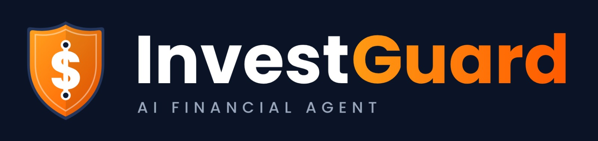

# 🏦 InvestGuard: agente bancário de IA seguro



Um agente de IA que consulta saldo e extrato, faz depósitos e saques e mantém o dinheiro **rendendo num investimento seguro por padrão** ("dinheiro em repouso que rende"). Ele também mostra um top de recomendações de investimento do momento: você escolhe uma ou pede para o agente escolher pelo critério que ele julgar melhor.

A ideia central de segurança: **a LLM só propõe ações; quem decide é um policy engine determinístico, escrito em código.**

🥉 **3º lugar** no Café em Código Experience (Time 5) · 🤖 Construído com Devin
⚠️ **Projeto educacional:** o banco é simulado, nenhum dinheiro real é movimentado.

O projeto segue as camadas de governança e segurança do **OWASP Top 10 for Agentic Applications 2026**.

---

## ⚠️ Compatibilidade de LLM

**Por enquanto, o Cofre funciona com a API da Anthropic (Claude).** Não há suporte a outros provedores (OpenAI, Gemini etc.) nesta versão.

Existem dois modos de uso:

| Modo | Precisa de chave? | Para que serve |
|---|:-:|---|
| **LLM simulada (fake)**, padrão | Não | Testar o projeto, rodar a demo e os testes. Exercita as camadas em código (policy engine, 2FA, guardrails). |
| **Claude (API da Anthropic)** | Sim | Conversa de verdade em linguagem natural. É o modo recomendado para avaliar o agente completo. |

---

## 🚀 Início rápido (sem chave de API)

**Windows**
```
py -m venv .venv
.venv\Scripts\activate
pip install pytest
py web.py
```

**Linux / macOS**
```
python3 -m venv .venv
source .venv/bin/activate
pip install pytest
python3 web.py
```

Depois abra **http://localhost:8000** no navegador.

---

## 🔑 Usando o Claude de verdade (passo a passo)

Para o agente usar o Claude, você precisa de uma chave da API da Anthropic e de um arquivo chamado `.env` com essa chave dentro.

### 1. Obtenha sua chave
Crie uma conta e gere uma chave em **https://console.anthropic.com** (menu *API Keys*). Guarde a chave, porque ela só é mostrada uma vez.

### 2. Instale as dependências extras
```
pip install anthropic python-dotenv
```

### 3. Crie o seu arquivo `.env` a partir do `.env.example`
O repositório traz um arquivo-modelo chamado **`.env.example`**, com os nomes das variáveis e nenhuma chave real. O programa procura um arquivo chamado exatamente **`.env`** (com o ponto na frente e sem nada depois). Por isso você precisa criar essa versão com o nome certo.

O jeito recomendado é **copiar** o modelo, mantendo o original intacto:

**Windows (Prompt de Comando ou PowerShell)**
```
copy .env.example .env
```

**Linux / macOS**
```
cp .env.example .env
```

> 💡 Se preferir **renomear** em vez de copiar, também funciona na sua máquina: no explorador de arquivos, clique com o botão direito em `.env.example` → Renomear → `.env`. Só tenha em mente que, assim, você perde o arquivo-modelo no seu clone.
>
> No Windows, se o explorador não deixar salvar um nome que começa com ponto, use o comando `copy` acima.

### 4. Cole a sua chave no `.env`
Abra o `.env` em qualquer editor de texto e preencha a linha da chave, sem aspas e sem espaços:

```
ANTHROPIC_API_KEY=sua-chave-aqui
```

Troque `sua-chave-aqui` pela chave que você gerou no passo 1 e salve o arquivo.

### 5. Rode com o Claude
```
py web.py --llm anthropic          # interface no navegador (Windows)
py cli.py --llm anthropic          # chat no terminal (Windows)
```
No Linux/macOS, troque `py` por `python3`.

---

## 🧪 Todos os comandos

| Comando (Windows) | O que faz |
|---|---|
| `py web.py` | Interface visual no navegador (http://localhost:8000) |
| `py demo.py` | Roteiro de demonstração de 2 minutos |
| `py cli.py --customer c-001` | Chat no terminal (o código 2FA aparece como "SMS simulado") |
| `py redteam\run.py` | Red team: ataques contra o próprio agente, gera `redteam\report.md` e `report.json` |
| `py -m pytest -q` | Testes automatizados |

Adicione `--llm anthropic` a `web.py` ou `cli.py` para usar o Claude (veja a seção acima).

**Clientes de exemplo:** `c-001` (R$ 8.500), `c-002` (R$ 1.200,50), `c-003` (R$ 30.000).

> **Sobre o red team:** com a LLM simulada, a taxa de bloqueio mede apenas as **camadas em código** (policy engine, guardrails, limites). Rode também com o Claude real para avaliar o comportamento do agente completo.

---

## 💬 Exemplo de conversa (ilustrativo)

```
Você:  quero depositar 500 reais
Cofre: Vou depositar R$ 500,00. Para confirmar, responda CONFIRMO <código>
       (enviado por SMS simulado).
Você:  CONFIRMO 482913
Cofre: Depósito realizado. Seu dinheiro já rende no investimento seguro.
```

O texto exato das respostas pode variar. O ponto importante é o fluxo: o agente propõe, o código exige confirmação e 2FA, e só então a operação é executada.

---

## 🏗️ Arquitetura

```
Cliente -> identidade (customer_id da sessão) -> rate limit / disjuntor / kill switch -> guardrail de ENTRADA
  -> LLM (só PROPÕE, em JSON validado) -> POLICY ENGINE determinístico -> tools do banco simulado
  -> resposta montada pelo sistema com os números da tool -> guardrail de SAÍDA -> cliente
```

- **"CONFIRMO <código 2FA>"** é tratado por código, sem passar pela LLM: hash da proposta + OTP de uso único + expiração em 2 turnos.
- **Tudo** é registrado em `audit.jsonl` (somente adição, com dados sensíveis mascarados).

### Principais arquivos
```
cofre/
  agent.py        orquestração do agente
  bank.py         banco simulado, tools e tabela de permissões
  policy.py       policy engine determinístico
  guardrails.py   proteções de entrada e saída
web.py            interface no navegador
cli.py            chat no terminal
demo.py           roteiro de demonstração
redteam/run.py    ataques automatizados contra o agente
```

---

## 🛡️ Segurança: OWASP → controle → arquivo

**ASI** (*Agentic Security Issue*) é a numeração dos riscos do OWASP Top 10 for Agentic Applications. A tabela mostra como cada risco coberto é tratado no projeto.

| ASI | Controle | Onde |
|---|---|---|
| 01 Goal Hijack | regex de injeção, normalização unicode, envelope `<<dados>>`, prioridade no prompt | `guardrails.py`, `agent.py` |
| 02 Tool Misuse | tabela de permissões, policy engine, sem tool de PIX/transferência | `bank.py`, `policy.py` |
| 03 Identity | `Ctx` vem da sessão; args com conta/cliente → NEGADO | `bank.py`, `policy.py` |
| 05 Code Exec | nenhum eval/exec; código/URL bloqueados | `guardrails.py` |
| 06 Memory | histórico curto por sessão; limites só no código | `agent.py`, `bank.py` |
| 08 Cascading | 1 escrita/turno, sem retry de escrita, timeout, disjuntor, rate limit | `policy.py`, `agent.py` |
| 09 Trust | CONFIRMO + 2FA, aviso de risco fixo, "não é promessa de ganho" | `policy.py` |
| 10 Rogue | kill switch `AGENT_ENABLED=false`, auditoria, alerta após 3 bloqueios | `policy.py`, `agent.py` |

> Os itens 04 e 07 do Top 10 não estão mapeados nesta versão do protótipo.

---

## 🧰 Tools e permissões

Definidas em `cofre/bank.py::PERMISSOES`.

| Tool | Lê | Escreve | Limite |
|---|:-:|:-:|---|
| consultar_saldo | ✔ | | só a conta da sessão |
| consultar_extrato | ✔ | | máx. 90 dias / 50 itens; padrão 30 dias / 10 itens |
| depositar | | ✔ | ≤ R$ 5.000/op; > R$ 10.000/dia vai para o operador; 2FA |
| sacar | | ✔ | 2FA sempre; > R$ 1.000 alerta; > R$ 5.000 operador; > R$ 20.000 negado |
| listar/simular_rendimento | ✔ | | catálogo imutável; sugestão por regra de horizonte |
| definir_rendimento | | ✔ | só códigos do catálogo; 1 alteração/dia; aviso de risco; 2FA |

---

## 📐 Decisões de projeto

| Tema | Decisão |
|---|---|
| Saque > R$ 5.000 | CONFIRMO + 2FA, depois fila do operador; teto de R$ 20.000 só com aprovação humana; acima disso, negado |
| Quem decide a confirmação | Policy engine. **Toda escrita** pede CONFIRMO + código 2FA de 6 dígitos (enviado fora do chat) |
| Confirmação | Executada por código, não pela LLM. Anti-replay (uso único + hash da proposta), 3 tentativas, expira em 2 turnos |
| Depósito > R$ 10.000/dia | Vai para o operador (não é recusado) |
| Idempotency key | Gerada pelo sistema (`session_id:hash_da_proposta`), nunca pela LLM |
| Rate limit | 8 mensagens a cada 10 s por sessão (ataque "20 pedidos em 10 s") |
| Risco | Escala numérica: nenhum < baixíssimo < baixo < baixo-moderado; acima de baixíssimo, aviso fixo de risco |
| Anti-alucinação | Valores mostrados ao cliente são formatados pelo sistema a partir do retorno da tool |

---

## 🗺️ Próximos passos

- Suporte a outros provedores de LLM (hoje, apenas Anthropic).
- Cobrir os riscos OWASP ainda não mapeados (04 e 07).
